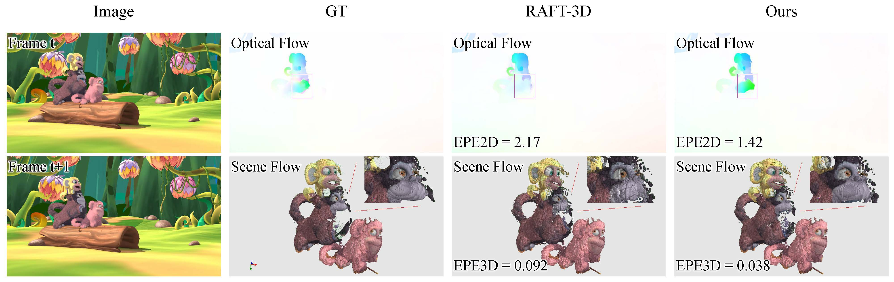

[//]: # (@File: README.md)

[//]: # (@Project: SplatFlow3D)

[//]: # (@Author : wangbo)

[//]: # (@Time : 2026.11.10)

# SplatFlow3D: Learning Scene Flow via 3D Motion Feature Splatting
This repository contains the source code for our paper:
- SplatFlow3D: Learning Scene Flow via 3D Motion Feature Splatting (T-CSVT 2026)
  
  - [x] We propose a novel two-frame method, SimpleFlow3D, which integrates dense information from the image plane and sparse information from the depth dimension in a decoupling-followed-by-coupling manner by hierarchically constructing the 3D motion feature. 
  - [x] We propose a new multi-frame method, SplatFlow3D, by combining the proposed backbone with a weight-sharing multi-frame framework. The framework unifies the first and non-first frame inference by constructing pseudo inputs. 
  - [x] The two methods achieve SOTA results on all mainstream scene flow datasets with minimal parameters. 
  - [x] Experiments show that SplatFlow3D improves occlusion handling, non-rigid motion estimation, and generalization to real-world scenes. 

## Updates
- [2026.11.10] 📣 The code of SplatFlow3D is coming soon!
- [2026.11.10] 📣 The paper of SplatFlow3D is coming soon!
- [2026.11.04] 📣 The paper of SplatFlow3D is accepted by T-CSVT 2026!
- [2023.08.23] 📣 Our method ranked **first** on the leaderboard of [Spring](https://spring-benchmark.org/sceneflow) Scene Flow.
- [2023.02.23] 📣 Our method ranked **first** on the leaderboard of [KITTI](https://www.cvlibs.net/datasets/kitti/eval_scene_flow.php) Scene Flow.


## Acknowledgments

SplatFlow: Learning Multi-frame Optical Flow via Splatting (IJCV 2024) | [Paper](https://arxiv.org/pdf/2306.08887.pdf) | [Code](https://github.com/wwsource/SplatFlow)

## Citing this Work

If you find our repository useful, please consider giving it a star ⭐ and citing our paper in your work:

```bibtex
@article{wang2026splatflow3d,
  title={SplatFlow3D: Learning scene flow via 3D motion feature splatting},
  author={Wang, Bo and Zhenping Sun and Yu, Yang and Jian Li and Li Liu and Hu, Dewen},
  journal={IEEE Transactions on Circuits and Systems for Video Technology},
  year={2026},
  publisher={IEEE}
}
```